# 13. Filtering 6가지 전략

- DynamoDB에서 필터링은 거의 전적으로 프라이머리 키를 기준으로 이루어진다. 따라서 키를 어떻게 설계하고, 쿼리하고, 인덱싱하는지가 DynamoDB를 잘 쓰는 데 핵심이다.

## 전략1. PK 필터링
- PK == 파티션 키
- Query API 자체가 Partition 기준 Filtering 된 결과값으로 해석 가능
- GSI의 PK == 그룹핑할 기준(필터링)
-> PK 간의 필터링을 하지 못하면 Scan이라는 heavy한 필터링 연산을 진행해야함

## 전략2. SK 필터링
- base table/ index table 둘다 가능한 방식

### 2-1) Simple Filter
- 특정 파티션 내의 SK 범위 검색 - (PK:CustomerId - SK: OrderTime) - 특정 소비자의 주문시간 기반 범위 검색 가능
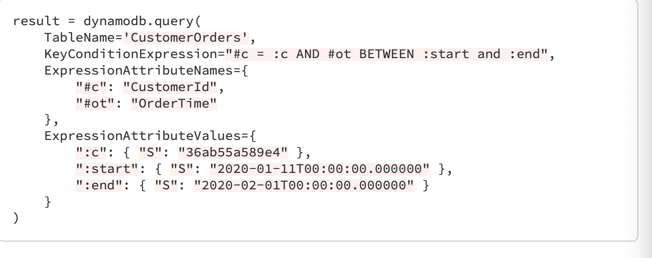

### 2-2) Assembling different collections of items
- 다른 유형의 엔티티를 한번에 조회하기 위한 필터링
- ex) 특정 레포의 이슈 목록을 레포 정보와 함께 가져올때 
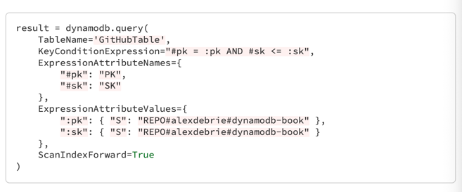
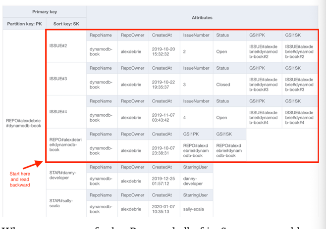
-> 레포로부터 시작해서 backward로 이슈 탐색함
  
- 반대로 레포보다 큰 SK들을 기준으로 조회하면 STAR들을 찾을 수 있음
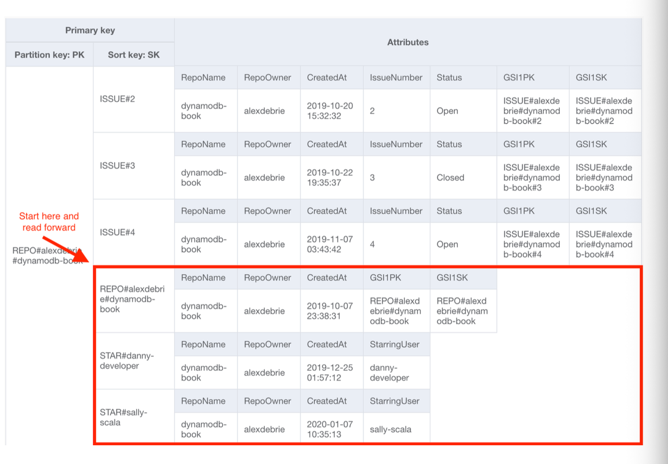

## 전략3. Composite sort key
- 다양한 데이터값을 Sort Key로 지정 
- ex) 특정 기간의 특정 상태에 대한 주문 조회 (CANCELLED/ 18-01 ~ 18-09)
  - OrderStatus(Status와 주문 일자를 함께 합친 SK로 대응가능)
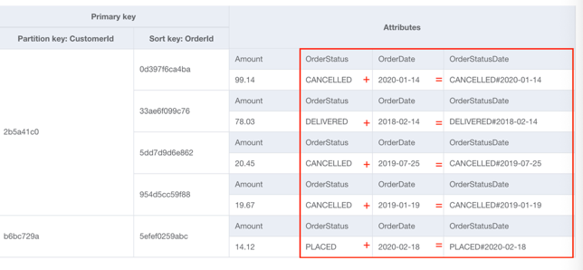
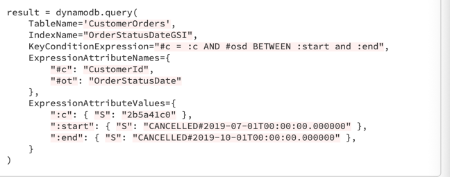

- 다음 특징들을 만족할 때 복합 SK가 효율적이다
  - 속성이 enum 값들로 규정될 때
  - 언제나 복합 속성들의 고정된 특정 엑세스 패턴을 추종할 때 -> OrderStatus + OrderDate 엑세스 패턴

## 전략4. 희소 인덱스 패턴
- GSI PK, SK가 모두 존재하는 아이템만 현출되는 현상을 이용한 패턴
- 조건을 충족하지 않은 entity들을 자동으로 걸러낼 때 좋음

### 4-1) 아이템 타입별 글로벌 필터링을 위한 희소 인덱스
- SaaS User들 중에 admin 권한 있는 유저 필터링 
- GSI1PK(Type), GSI1SK(Role)만들고 Admin만 키 채워넣어서 admin GSI에 모아놓음
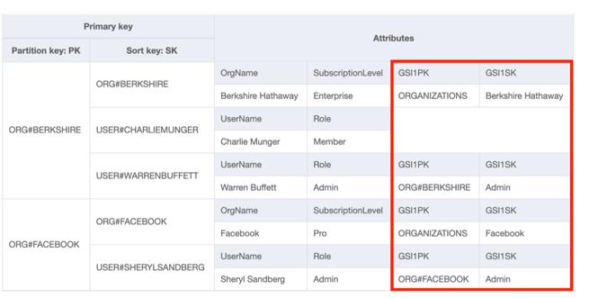

### 4-2) 여러 엔티티가 존재하는 Single Table에서 Sigle Tpye Entity만 프로젝션을 위해
ex) Customer, Order, Inventory가 있는 상황
- hot sale이나 신제품 마케팅 이벤트를 위한 고객들의 이메일이 발송이 필요해짐
- 고객들만 모아놓은 인덱스 설계 -> Attribute CustomerIndexId 추가
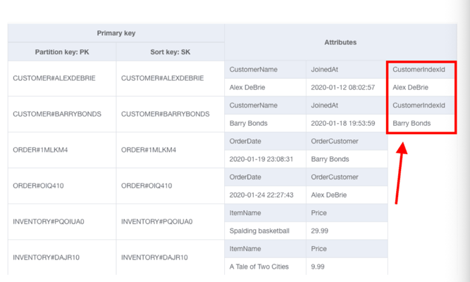

## 전략5. Filter Expressions(차안)
- 필터링은 대부분 키 설계로 하고 필터 표현식은 보조수단이다.

### 문제1. 필터링 전으로 경계가 계산되므로 사용자 정의 페이지를 채우기 위한 무한 조회 발생 가능
- 써도 되면 좋은 시점
  - 응답 크기를 줄이기 위한 관점 : 어차피 버릴 데이터를 서버쪽에서 거르기
  - 어플리케이션 코드 단순화 : 받아온 뒤 filter로 버릴거면 요청 단계에서 거르는게 편할 수 있음
  - TTL 만료 보정 : TTL 삭제는 만료 후 최대 48시간 까지 지연 가능
-> 그럼에도 필터 통과율이 30-40%이거나 필터 전 결과 크기가 작은 케이스에만 운용 추천
-> 그렇지 않으면 RCU는 다 소비하고 결과는 대부분 버리는 셈

### 문제2. 사용자 정의 page size를 위해 몇개를 읽어야할지 모름
- GET /orders가 SHIPPED 주문 10개 반환 시 필터 표현식으로 구현하면 몇개 일어야 10개를 채울 수 있을지 모름
> 과하게 많이 읽거나 추가 요청이 필요한 케이스가 생김
> 반대로 복합 정렬 키에 포함시키면 Limit 10만으로 정확히 10개 가져올 수 있음 

## 전략6. 클라이언트 필터링
- 상황1) 필터링이 데이터베이스에서 모델링하기 어려울 때
- 상황2) 데이터셋이 크지 않을 때 -> 그냥 전체 보내고 클라가 필터링하도록 하기

---

# 14. Sorting 전략 6가지

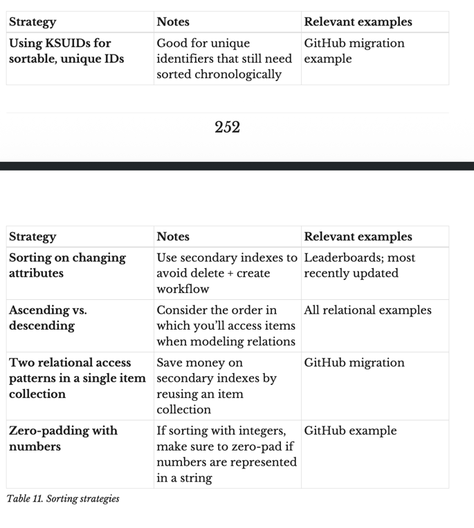

정렬을 위한 두가지 Main Rule
- 복합 PK를 써야한다
- SK를 통해 정렬되어야 한다

## Basics of sorting
- string & binary 일때는 UTF-8 bytes 형태로 정렬됨
- Lexicographical sorting(사전식 정렬)
  - 대문자 가 소문자보다 먼저 온다 -> 대문자 룰을 잘 기억하거나 소문자로 통일하기!
  - 숫자와 상징은 relevant too
- Timestamp 정렬
  - 정렬 가능한 숫자여야 함 -> May 6, 1988 이런건 숫자별 정렬이 힘듦
  - 큰 차이는 없지만 ISO-8601(2020-03-06T15:14:15)이 epoch보다 human-readable이라 추천
- Unique, sortable IDS
  - KSUID(K-Sortable-Unique Identifier) : prefixed된 timestmap가 있고 충분한 랜덤성도 있음
  - 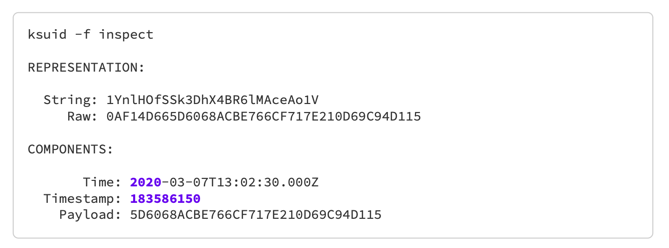

## KSUID (K-Sortable Unique IDentifier)

### 구조 (20바이트)
- **앞 4바이트: 타임스탬프** (초 단위, 커스텀 에포크 기준)
- **뒤 16바이트: 랜덤 값** (충돌 방지)
- 문자열로는 base62로 인코딩된 27자로 표현
    - 예: `0ujtsYcgvSTl8PAuAdqWYSMnLOv`

### DynamoDB에서 유용한 이유
- 정렬 키(sort key)는 사전순(lexicographic)으로 정렬되는데, KSUID는 앞부분이 타임스탬프라 **문자열 정렬만으로 시간순 정렬**이 된다.
- 주문 ID 등을 KSUID로 만들어 정렬 키에 넣으면, 별도의 타임스탬프 속성 없이도 "최신 순 조회" 같은 접근 패턴을 바로 처리할 수 있다 (`ScanIndexForward=false`).
- 랜덤 부분 덕분에 같은 초에 여러 개가 생성돼도 **고유성이 보장**된다.
- UUID v4(완전 랜덤, 정렬 불가)와 단순 타임스탬프(충돌 위험)의 장점을 합친 형태다.

---

## 변경 필드 정렬
- 변경 필드를 SK로 하면 -> 삭제/삽입을 매번 반복해야함
- PK-SK는 변동하지 않는 필드로, GSI를 통해 변경 필드를 SK로 삼도록 변경

---

## 오름차순 vs 내림차순
- ScanIndexForward=True -> 오름차순으로 읽음
- ScanIndexForward=False -> 내림차순으로 읽음
- Backward가 필요한 경우에는 특정 기준값이 밑에 위치하도록 prefix '#' 커스텀 가능
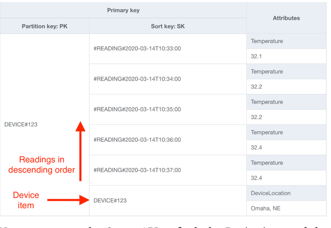

## Two Relational access patterns in an single item collection
- Org를 경계로 내림차순 스캔하면 Team 들을, 오름차순 스캔하면 User들을 스캔 가능함
- 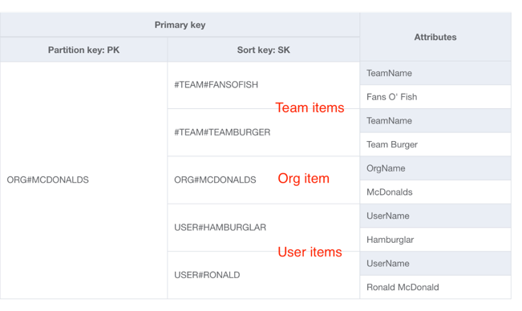

## Zero-padding with numbers
- 숫자를 나열할 때 문자로 취급받으면 10 > 2가 되지만 000010로 제로패딩을 두면 제대로 오름차순 정렬됨
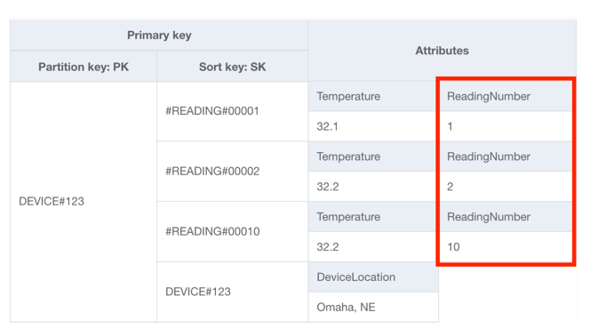

## Faking 오름차순
- 내림차순으로 정렬하고 싶을 때 -> 99999 - Reading Number로 나열 순서로 변경가능
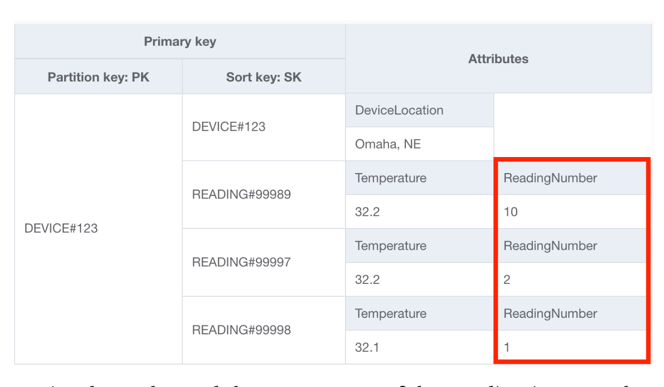
