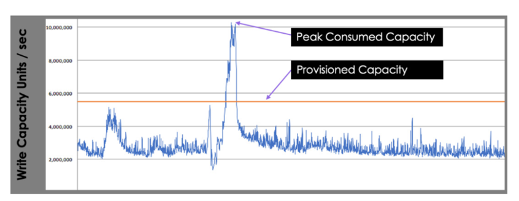
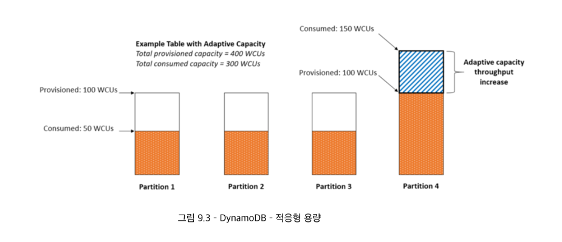
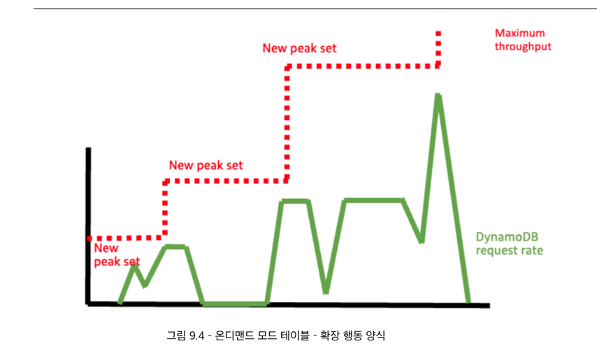
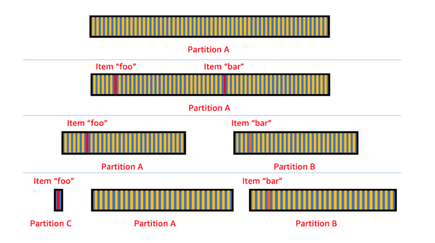
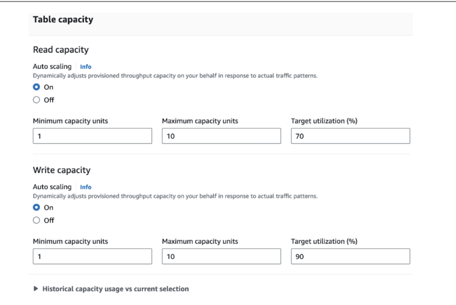

# 9. 용량 모드들
- 테이블 생성 된 이후에도 수정 가능함

- provision capacity : 예약된 용량
- on-demand capacity : 필요에 따른 용량 모드

## 1. provision capacity mode
- 예상되는 트래픽량이 일정 -> 미리 트래픽에 맞는 좌석과 인력 확보 가능
- 참석자 수가 크게 변동 or 예측하기 어려움 -> 리소스가 과소 활용 가능성이 있음
- 초당 처리해야하는 읽기 작업 / 초당 수행되어야하는 쓰기 작업 수 결정 가능
  - RCU : 1개  - 8KB 최종적 일관성 or 4KB 강력한 읽관성
  - WCU : 1개 - 1KB 이하인 데이터 쓰기 작업
  - 하나의 파티션 제한 요건 : 1000 WCU, 3000RCU, 10GB
- 이 설정값을 초과하는 요청들은 DDB에 의해 제한될 수 있음

### Burst Capacity 
- Provision Mode에서 예상치 못한 트래픽 및 작업량 증가에도 원활히 대응가능하게 해줌
- 테이블에 할당된 용량 중 아직 사용되지 않은 부분을 활용해 테이블이 할당된 용량을 초과할 수 있도록 함
- DDB에서 5분 동안 사용되지 않은 용량 기록해둠 -> 트래픽 초과 시 용량을 추가적으로 사용가능하도록 함 

- 550 WCU예측 -> 1000 WCU를 갑자기 찍었는데도 성능 저하 없이 트래픽 증가를 원활히 처리 가능
- 순간적으로 Provision Capacity를 넘어섰어도 이전에 사용되지 않는 자원을 대여해 사용가능하게 해줌
- but, 소비된 용량이 지속적으로 높을 경우 버스트 용량 소진 할 것 -> 따라서 일시적인 유연성이라고 생각하면 됨

### Adaptive Capacity : 적응 능력
- 워크로드에 따라서 자동으로 불균형한 트래픽을 다룰 때 강력함
- 파티션 트래픽에 따라 각자 알맞는 용량을 할당함

- ex) 4개의 파티션에 기본 50 WCU 트래픽 -> 400WCU를 전체 설정으로 지정하면 각각 100씩 할당
- but, 하나의 파티션에 쓰기가 몰리면 최대 한도까지(1000WCU, 3000 RCU) 성능을 동적으로 향상시켜줌

### 계량, 측정
- Provision 모드에서 시간단위로 측정 및 청구됨
- 각 시간 내의 임의 시점에서 테이블의 예약된 용량을 기록
  - 대부분 100 WCU였지만 몇 초동안 10000WCU로 일시적으로 증가 -> 100 or 10000 WCU 중 하나로 전체 시간 요금 청구 가능
  - 비용 추정을 위해서는 테이블의 한 시간 동안 가장 높은 예약 용량으로 가정하고 추론하는 것이 바람직함

## 2. 온디맨드 용량 모드
- 테이블이 필요에 따라 자동 확장됨 -> 사용 패턴이 예측 불가하고 요청 빈도가 크게 변동하는 서비스
- 트래픽에 따라 요금 부과 + 고정비(데이터 저장 비용은 무조건 나감)
- 사전에 읽기, 쓰기 용량을 미리 지정할 필요가 없음

### 2-1) 확장 특성
- 몇 분마다 이전 최대 처리량(테이블의 제한 시간 동안이 최대 읽기-쓰기 트래픽)의 2배까지만 성능 확장 가능
- 처음부터 온디맨드 설정 시 초기값 : 4000 WRU, 12000 RRU 설정됨
- provision -> on-demand 시 설정 값 : max(해당 테이블의 역사적 최대 용량, 4000 WRU 이상, 12000 RRU) 이상 중 큰 값
- 
- 테이블이 소비하는 처리량이 이전 최대 처리량에 근접 시 5-30분 마다 처리량이 두배로 증가함
- 요청 트래픽이 전혀 없는 구간에도 시스템은 과거에 기록된 최고 성능 수준을 기억하고 있음
- 테이블에서 사용되는 처리량을 지속적으로 모니터링하고 제공된 처리량과 비교해 동작
  - 자동 확장을 통해 부여 가능한 최소, 최대 용량을 설정 가능

### 2-2) 계량/ 측정
- 한달 동안 요청 횟수에 따라 요금 부과

## 3. 둘다 지원되는 공통 기능

### 3-1) 자주 접근되는 항목을 분리해 저장
- 핫키 항목들을 파티션 분할을 통해 각각 트래픽이 분산되도록 -> 그래도 트래픽이 몰리면 별도로 관리해 저장
- 사후 대응적인 조치이며 사전 예방적인 조치는 아님

### 3-2) Provision -> 자동 스케일링 기능

- RCU, 테이블의 할당 용량의 70%를 초과 -> 용량 늘리기
- 만약 할당된 용량의 비율이 70%라는 target 값 밑으로 떨어지면 용량을 줄이는 조치가 취해짐
- 자동확장 기능은 2분간 데이터를 분석해 테이블이 사용하는 용량을 측정 
- CloudWatch 매트릭 전달, 자동 스케일 설정에 따른 알림 등으로 인해 트래픽 량이 목표 초과부터 실제 스케일링까지는 4-6분 소요됨
- 축소 작업의 경우 15분간 데이터를 분석해 결정

### 3-3) 사전 용량 예약을 통한 비용 최적화
- 특정 기간 동안 미리 정해진 양의 처리량 확보 가능 -> 1 or 3년
- 미리 예약함으로써 일반 가격보다 더 많은 비용을 절약 가능함
- 초기에 확보한 부분에 대해서만 할인율이 들어가고 이후에 있어서는 추가로 책정됨
- 사전에 용량을 구매하면 1년 계약 시 기존 시간 당 요금 대비 최대 54%, 3년 계약 시 77% 절약 가능
- 한번 지불하는 선불 요금 + 구매 기간 동안 매 시간마다 부과되는 요금으로 청구됨
  - 예를 들어 100 WCU 사전 구매하면
    - 1회성 선불 요금 : 150달러 + 시간 당 요금(.0128$) -> 한달 730시간으로 지정하면 262.128달러
    - 만약 그냥 사용하면 569.4달러가 됨

## 적절한 용량모드 선택의 기준
- Provision mode 추천
  - 안정적이고 예측 가능한 트래픽 == 스파이크 없는 트래픽
  - 알려져 있고 통제 가능한 요인들에 의해 결정됨
  - 지속적으로 모니터링 가능

- 온디맨드 추천
  - 예측 불가하고 자주 트래픽이 없는 구간이 있음
  - 알 수 없고 통제할 수 없는 요인들에 의해 결정됨

## 테이블 클래스
- 스토리지 비용 : Standard 클래스> Standard-IA(60%에 불과)
- 처리 속도 : Standard 클래스> Standard-IA
- 저장된 데이터 양에 비해 읽기/쓰기 요청이 많은 경우 / 처리 속도와 스토리지 비용이 비례하는 워크로드 -> Standard
- 대량의 데이터가 저장되어 있지만 특정 시점에 접근되는 데이터양이 적음 -> Standard-IA

## 테이블 클래스 고려사항들
- 30일 동안 최대 2번 변경 가능
- 예약된 용량 구매 할인율은 Standard-IA 클래스에는 적용되지 않음
- Standard 등급의 테이블에서 처리량과 저장비용 비교 시 저장 비용이 42%를 초과하면 Standard-IA가 비용 효율적 선택이 될 수 있음
- 
