# 19. Building e-commerce application
- Account Over View
- 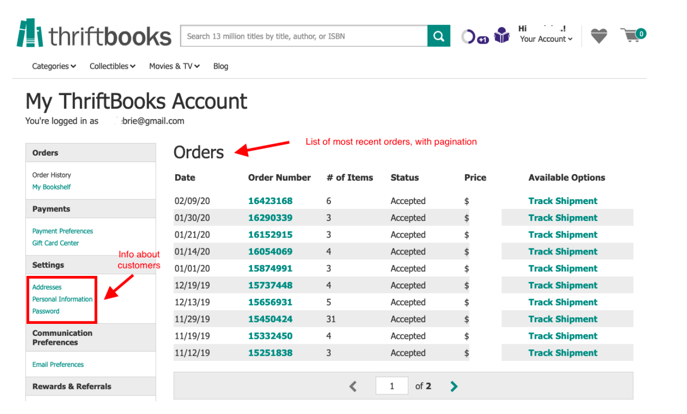
  - user 정보 : email, address
  - 최근 구매한 orders 정보들 with paginaiton
    - order date, order number, order status, number of items and total cost

- Order Detail Page -> 주문 하나에 대한 상세 정보
  - 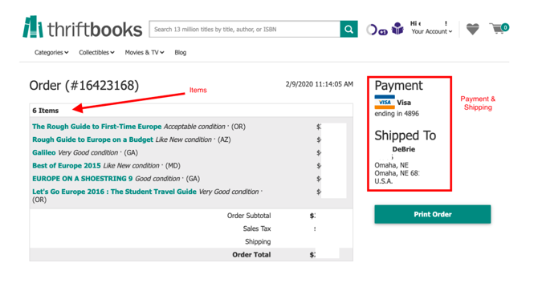
  - Payment, Shipping, 각 어떤 정보들이 있는지

- Account Section 
  - 소비자는 여러 주소를 저장 가능함, {"Home", "Parent House"}
  - user name이 unique 하지만 email도 함께 받아 사용 -> (email + username)이 각각 Unique 하길 바람

## 19-2) ERD
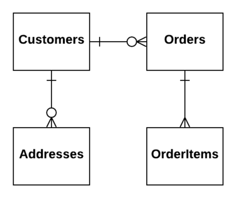
- Create Customer(unique both username , email)
- Create, Update, Delete Mailing Address for Customer
- Place Order
- Update Order
- View Customer + Most Recent ORders for Customer
- View Order & OrderItem

## 19-3) 내 생각

- Create Customer(unique both username , email)
  - Customer에서 SK에 따라 각각 구분되어야 함 -> (customer_id, username), (customer_id, email) 별도 저장
  - 하나라도 이미 있으면 create 호출하지 않음 -> TransactWrite  -> 고객 안으로 줄어짐
  - PK : CUSTOMER#<customer_id>, EMAIL#<email>, USERNAME#<이름>으로 해서 각각 TransactiWrite
  
- Create, Update, Delete Mailing Address for Customer
  - Email<#email>의 SK를 CustomerID로 두고, SK, PK를 바꾸어 GSI 생성
  - CUSTOMERID 기준을 EMAIL을 볼 수 있음
  
- Place Order
- Update Order
- View Customer + Most Recent ORders for Customer
  - Order에 들어가야 하는 것 -> Date, OrderNumber, Item 개수, Status, Price, AvaliableOptions
  - Orders에서 status는 꽤 변동성이 높은 필드임
  - Orders 테이블은 PK OrderID로 관리하고, GSI PK(CustomerId, SK, OrderDate로 관리) + keys_only
  - GSI에서 페이지만큼 가져오고 -> Orders테이블에서 BatchGetItems
- View Order & OrderItem
  - 항상 같이 조회되는 게 아니므로 OrderItem 테이블 분리
  - PK(OrderItem) + Attribute에 OrderId -> GSI로 (PK : OrderId) + SK(OrderItem_ID)

## 19-3 : WalkThrough

### Customer
- Customers는 username과 email 둘다 unique 해야 함
- 각각의 엔티티로 다루어 unique 함 보장 -> name을 customerID 대신 사용해 별도 엔티티 하나 줄임
- TransactWrite로 둘다 없을 때 Customer 생성 보장
- 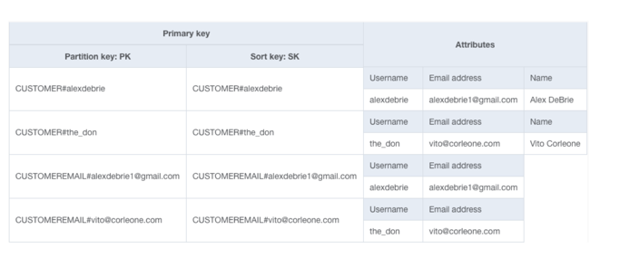
- 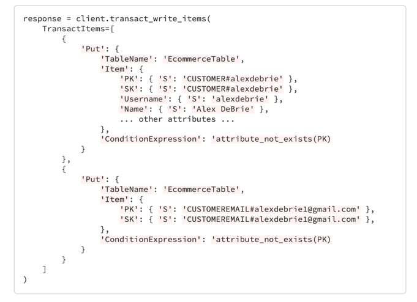

- 1:N 두개 - Address, Orders
- Address에 대한 두가지 질문
  - related entity가 value를 통해 접근되는 패턴 : 주소를 통해 Customer를 접근 하는 패턴이 있나? -> No
  - 데이터 량이 400KB에 부담되나?-> No
  - Set 속성으로 생성
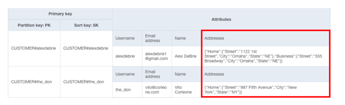

### Orders
- Customer가 Orders를 가지는 것처럼? -> 400KB 넘음
- PK: CUSTOMER#<Username>
- SK: #ORDER#<OrderId> <- #으로 시작해서 CUSTOMER가 가장 뒤에 오게 조정(ScanIndexForward=FALSE)
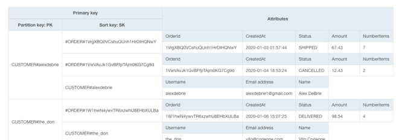

### OrderItems
- PK : ORDER#<OrderId>#ITEM#<ItemID>
- SK : ORDER#<OrderId>#ITEM#<ItemID>
- GSI1(Order)
  - PK : ORDER#<OrderId>
  - SK : ORDER#<OrderId>
- GSI1(OrderItem)
  - PK : ORDER#<OrderId>
  - SK : Item#<itemId>
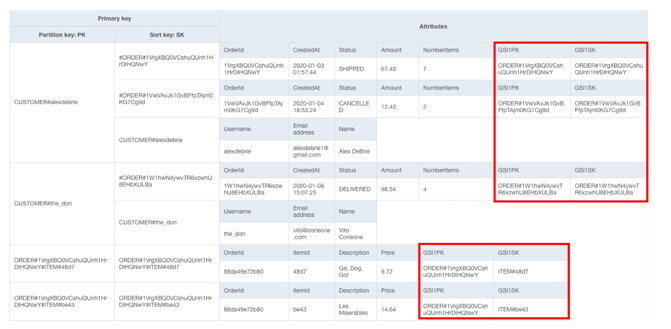
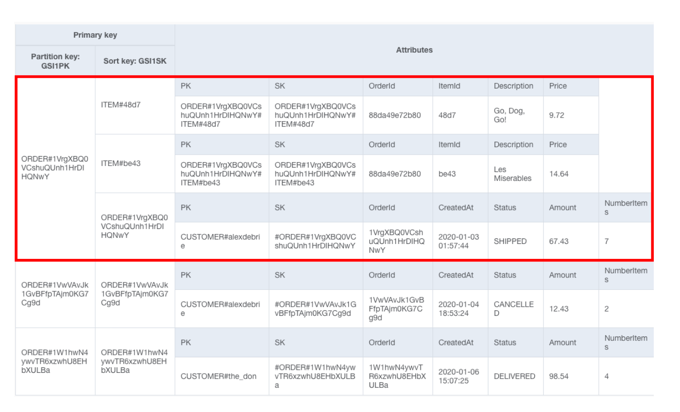
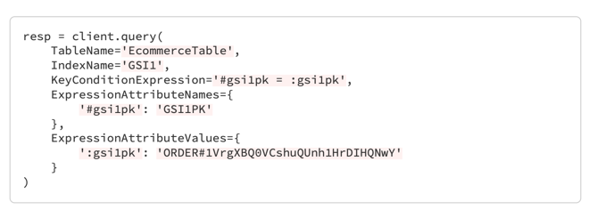

## Conclusion
- Data Modeling
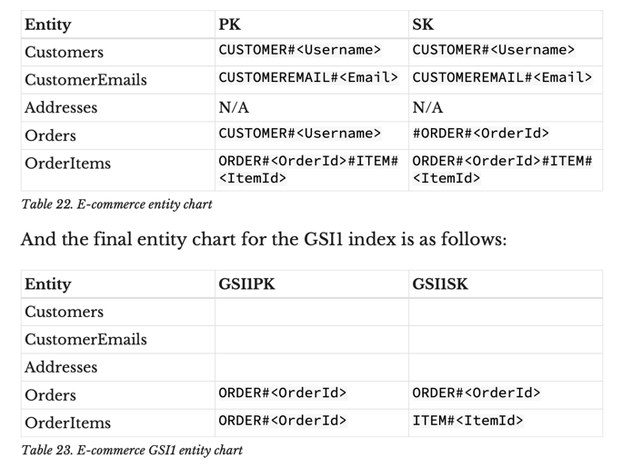

- Access Patterns
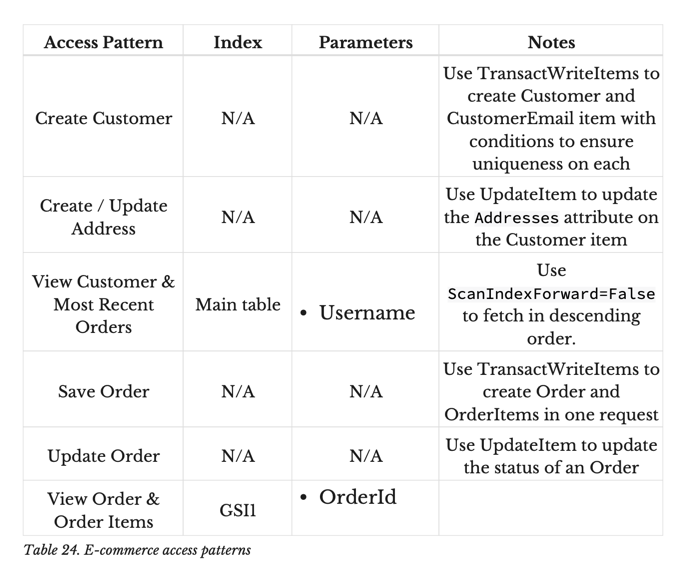
